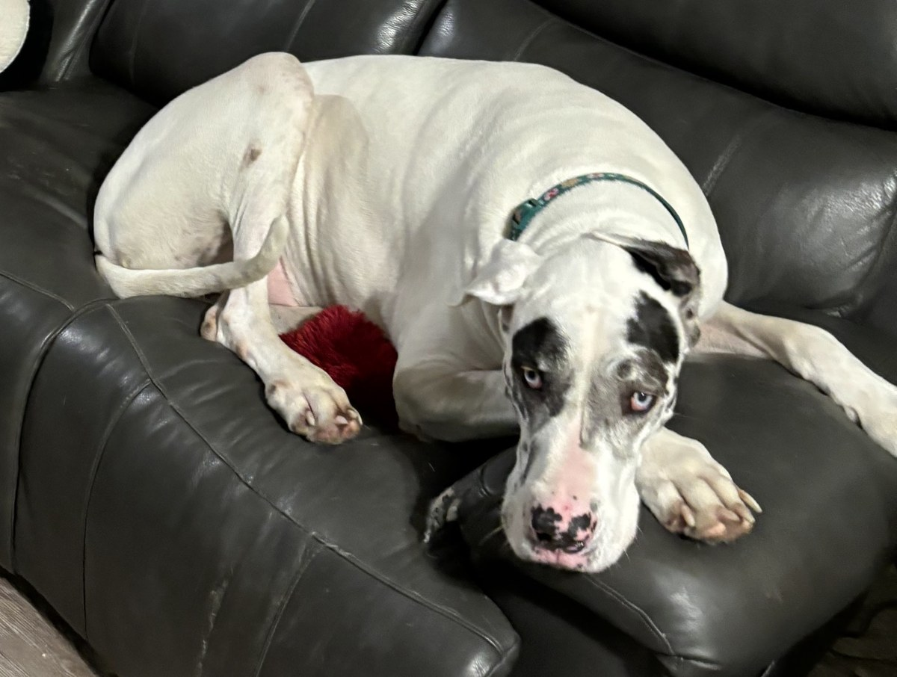
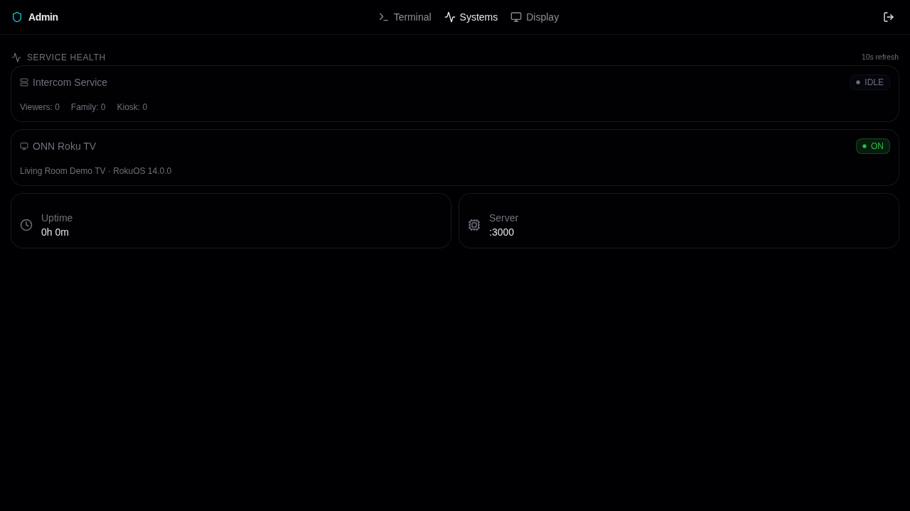

# MarshallCam

Self-hosted two-way video intercom: a TV kiosk at home so you can see and talk to dogs or family from your phone.

<p align="center">
  
</p>
<p align="center">
  <em>In memory of the best boy, Marshall Baney.</em><br>
  MarshallCam is named after him.
</p>

The kiosk is a Mac mini (or any Mac) on HDMI, running a Safari Web App that publishes a USB webcam. Remotes are a PWA on phones. Media is [LiveKit](https://livekit.io/). The Node server issues tokens, serves the apps, and optionally talks to a Roku TV over ECP.


*Station standby view on the TV kiosk.*


*Remote client in an active two-way call with the station (synthetic test-pattern video feeds).*


*Optional admin dashboard at `/max` showing service health and Roku TV status.*

## Features

- Station (TV) and remote (phone) roles in one PWA
- LiveKit rooms with STUN (optional TURN)
- PIN login for remotes; loopback auto-login for the kiosk
- Sessions survive server restarts (signed tokens)
- Boot-safe kiosk: waits for the server instead of wiping its token
- Optional admin dashboard at `/max`
- Optional Roku ECP TV control and AI proxy
- macOS installer, LaunchAgents, and an optional kiosk guard

## Architecture

```
 phone PWA ──► (tunnel) ──► MarshallCam :3000 ──► LiveKit :7880
                                   ▲
                          station Web App
                          (localhost kiosk)
```

See [docs/ARCHITECTURE.md](docs/ARCHITECTURE.md).

## Hardware

- Mac mini (or Mac) that can stay on, auto-login, and output HDMI
- HDMI TV
- USB webcam (for example a Logitech C922)
- Optional: Roku TV on the LAN for ECP power/input control
- Optional: Cloudflare Tunnel or Tailscale for remote access

## Quick start (macOS kiosk)

```bash
git clone https://github.com/baney75/marshallcam.git
cd marshallcam
./scripts/macos/install.sh --pin 123456
```

That installs Node, ffmpeg, and LiveKit via Homebrew, builds both clients, writes `.env`, renders LaunchAgents, and starts the server plus LiveKit.

Then:

1. System Settings → Users & Groups → automatic login for the kiosk account
2. Safari: open `http://localhost:3000/?role=station` → File → Add to Dock / Save as Web App as `MarshallCam.app` in `~/Applications`
3. Web App Settings → Websites → Camera and Microphone → **Allow**
4. Plug the Mac into the TV. `./scripts/macos/status.sh` should show `/healthz: OK`

Add `--with-cloudflared` to install a tunnel LaunchAgent (you still edit hostnames and `<TUNNEL-ID>` in `~/.cloudflared/config.yml`). Add `--system-settings` to apply `pmset` power restore / no-sleep via sudo.

Uninstall LaunchAgents with `./scripts/macos/uninstall.sh`.

### Development (any OS with Node 20+)

```bash
cp .env.example .env
# set STATION_PIN, LIVEKIT_API_KEY, LIVEKIT_API_SECRET
npm ci
npm --prefix client ci
npm --prefix client-max ci
npm run build
npm start
```

Point a browser at `http://localhost:3000/`. LiveKit must be running on `LIVEKIT_URL_LOCAL` for calls.

## Configuration

All site values live in `.env` at the project root (see `.env.example`). Existing environment variables are not overwritten. Paths in `.env` are optional; `DATA_DIR` defaults to `./data` and `LOG_DIR` to `./logs`.

| Variable | Default | Notes |
| --- | --- | --- |
| `PORT` | `3000` | HTTP listen port |
| `STATION_PIN` | required | 4–8 digits |
| `ADMIN_PASSWORD` | unset | Unset disables `/max` |
| `LIVEKIT_API_KEY` / `LIVEKIT_API_SECRET` | required | Also written into `~/.config/marshallcam/livekit.yaml` |
| `LIVEKIT_URL_LOCAL` | `ws://127.0.0.1:7880` | Station / same-host |
| `LIVEKIT_URL_LAN` | from `SERVER_LAN_IP` | Optional LAN clients |
| `LIVEKIT_URL_PUBLIC` | unset | Used when `Host` is in `PUBLIC_HOSTNAMES` or the request has proxy headers |
| `PUBLIC_HOSTNAMES` | empty | Comma-separated |
| `SERVER_LAN_IP` | unset | Optional |
| `TV_IP` / `TV_ECP_PORT` | unset / `8060` | Roku ECP; TV routes 404 when unset |
| `ADMIN_AI_URL` | unset | AI proxy disabled when unset |
| `FFMPEG_PATH` | `ffmpeg` or Homebrew | Legacy dogcam path |
| `DATA_DIR` / `LOG_DIR` | `./data` / `./logs` | |
| `SESSION_SECRET` | generated | Persisted at `DATA_DIR/session-secret` mode 0600 |
| `STATION_TOKEN_TTL_DAYS` | `3650` | Kiosk token lifetime |
| `SESSION_TTL_HOURS` | `720` | PIN / admin sessions |
| `ICE_SERVERS_JSON` | Google STUN | |
| `APP_NAME` / `APP_TAGLINE` | MarshallCam / Two-way video intercom | UI strings |
| `KIOSK_APP_PATH` | `$HOME/Applications/MarshallCam.app` | Guard |
| `KIOSK_BUNDLE_ID` | from Info.plist | Guard / PIN helper |
| `GUARD_REOPEN_TAILSCALE` | `0` | |
| `AV_INPUT_DEVICE` / `AV_OUTPUT_DEVICE` | unset | Skip AV lock when empty |

## Making it reliable

- **Auto-login** the kiosk macOS user.
- **Power restore:** `./scripts/macos/install.sh --system-settings` sets `pmset autorestart 1 sleep 0 displaysleep 0 disksleep 0` and `systemsetup -setrestartfreeze on`.
- **Safari Web App** with Camera and Microphone set to Allow once. The OS will not keep prompting if the site is allowed.
- **Guard:** LaunchAgent `com.marshallcam.guard` runs `scripts/macos/kiosk-guard.sh` every 60s. It waits 90s after boot, checks `/healthz` and `/station/health`, reopens the app with backoff, and only types the PIN as a last resort.

## Remote access

Do not forward LiveKit or the MarshallCam port raw to the internet.

- **Cloudflare Tunnel:** copy `deploy/cloudflared/config.yml.example`, replace `<TUNNEL-ID>` and `example.com` hostnames, then `./scripts/macos/install.sh --with-cloudflared`.
- **Tailscale:** serve `http://<tailscale-ip>:3000/` to your tailnet. Set `GUARD_REOPEN_TAILSCALE=1` if the guard should launch Tailscale.app.

Set `LIVEKIT_URL_PUBLIC` (for example `wss://livekit.example.com`) and list public hostnames in `PUBLIC_HOSTNAMES`.

## Troubleshooting

**PIN pad after reboot.** Fixed in 3.0.0: sessions are signed and stored, the kiosk retries `/healthz` instead of deleting its token on a failed fetch, and localhost calls `POST /station/session`. If you still see the pad, confirm the Web App URL is `http://localhost:3000/?role=station` (not a LAN IP or tunnel hostname) and that `/healthz` returns 200.

**Camera / microphone prompt every launch.** Set the Web App’s Camera and Microphone to Allow (Web App Settings → Websites). The guard’s `kiosk-allow-camera.sh` is only a fallback clicker.

**Admin dashboard 404.** `ADMIN_PASSWORD` is unset, so `/max` is disabled.

**TV controls 404.** `TV_IP` is unset.

## Security

Station auto-login is loopback-only and ignores proxied requests. Use a strong PIN and admin password. Never expose LiveKit API keys. See [SECURITY.md](SECURITY.md).

## Development

```bash
npm run typecheck
npm test
npm run build
```

License: MIT. Copyright © 2026 Donovan Baney.
